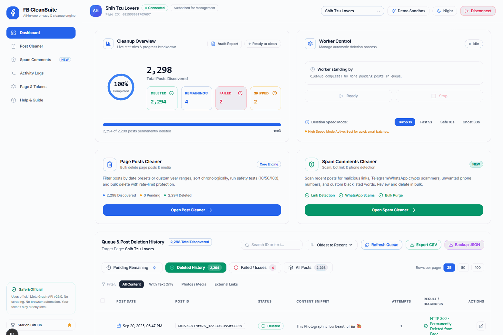

# 🚀 FB CleanSuite

<div align="center">

[](LICENSE)
[](https://nextjs.org/)
[](https://react.dev/)
[](https://www.typescriptlang.org/)
[](https://tailwindcss.com/)
[](https://developers.facebook.com/docs/graph-api/)
[](https://github.com/Wex-DE/FB-CleanSuite)

<p align="center">
  <strong>The Ultimate All-in-One Facebook Page Automation & Cleanup Engine</strong><br>
  <em>Bulk Delete Facebook Posts &bull; Auto-Clean Spam & Telegram Scam Comments &bull; 24/7 Auto-Pilot Sentinel &bull; Official Meta Graph API v26.0</em>
</p>

[Explore Features](#-core-capabilities) &bull;
[Why Choose FB CleanSuite?](#-why-fb-cleansuite-vs-alternatives) &bull;
[Quick Start](#-quick-start) &bull;
[Demo Sandbox](#-interactive-demo-sandbox) &bull;
[Safety Architecture](#-anti-ban--rate-limit-safety-architecture) &bull;
[Security & Privacy](#-security--privacy-guarantee)

<br><br>



</div>

---

## 📖 Overview

**FB CleanSuite** is an enterprise-grade, privacy-first desktop web application engineered for Facebook Page admins, digital agencies, content creators, and social media managers.

Built strictly on **official Meta Graph API v26.0 standards**, FB CleanSuite runs entirely on your local machine (`127.0.0.1:3000`). It eliminates the risk of account bans by avoiding unsafe browser automation, DOM scraping, and session cookie hijacking.

Whether you need to purge years of legacy posts, sanitize comment sections from malicious Telegram bots and WhatsApp crypto brokers, or schedule a 24/7 background guard — FB CleanSuite delivers unmatched speed, reliability, and security.

---

## ⚖️ Why FB CleanSuite vs Alternatives?

| Feature | Risky Chrome Extensions | Unofficial Python Scrapers | 🚀 **FB CleanSuite** |
| :--- | :---: | :---: | :---: |
| **Meta Account Ban Risk** | 🔴 Extremely High (DOM Injection) | 🔴 High (IP Flags / Checkpoints) | 🟢 **Zero / Anti-Ban Architecture** |
| **API Mechanism** | Web Scraping / Click Macros | Session Hijacking / Cookie Emulation | 🟢 **Official Meta Graph API v26.0** |
| **Data Privacy** | 🔴 Sends tokens to third-party servers | 🟡 Unknown cloud logging | 🟢 **100% Localhost Only (`127.0.0.1`)** |
| **Token Security** | 🔴 Stored in plaintext browser cache | 🔴 Plaintext `.env` / scripts | 🟢 **AES-256-GCM Server-Side Encryption** |
| **Spam Comments Cleaner** | ❌ None | ❌ Rare / Fragile | 🟢 **Full Page Scanner + Presets + Sentinel** |
| **Auto-Pilot Scheduler** | ❌ None | ❌ Requires custom cron setup | 🟢 **Built-in 24/7 Background Sentinel** |
| **Data Backup Before Delete** | ❌ No | ❌ Seldom supported | 🟢 **1-Click CSV & Full JSON Archive** |
| **Interactive Demo Sandbox** | ❌ None | ❌ None | 🟢 **Yes (Try without credentials)** |

---

## 🌟 Core Capabilities

### 1. 🗑️ Page Posts Bulk Cleaner
* **Chronological & Date Filtering:** Discover posts from specific date ranges, filter by year (e.g., 2021–2026), and sort **"Oldest to Recent"** (clean legacy posts first) or **"Newest to Oldest"**.
* **Smart Content Classification:** Filter discoveries by Text-Only, Photos/Videos, or External Links.
* **Safe 2-Step Verification:** Run a **Dry Run Discovery** to preview eligible posts, execute an optional **Small Test Deletion** (1, 5, or 10 posts), and only then confirm Full Cleanup.
* **Conservative 1-by-1 Deletion Worker:** Deletes posts serially with user-adjustable delay (Safe Mode 10s down to Turbo Mode 1s) and bounded exponential backoff.
* **1-Click Pre-Deletion Backup:** Download your complete post archive in formatted **CSV** (with direct Facebook links) and structured **JSON** before running bulk deletions.
* **Audio Chime & Web Notifications:** Gentle two-tone Web Audio chime and desktop notifications upon cleanup completion.

### 2. 🛡️ Spam & Toxic Comments Cleaner
* **Deep & Full Page Scan:** Scan the latest 15, 50, 100, or **All published posts** with adaptive pagination.
* **1-Click Threat Protection Presets:**
  - 🪙 **Crypto & Forex Shield:** Auto-targets Telegram bots, WhatsApp brokers, USDT scams, and wallet seed phrases.
  - 🎁 **Giveaways & Phishing:** Blocks fake iPhone rewards, lottery links, and gift card scams.
  - 🔞 **Adult & Dating Bots:** Filters explicit clickbait links and suspicious dating profiles.
  - 💼 **Work-From-Home Scam:** Catches fake daily earn tasks and part-time recruiter bots.
* **Visual Keyword Highlighter:** Amber highlights around detected spam triggers in comment text.
* **Domain & Term Whitelist:** Safeguards your official domains (e.g. `yourwebsite.com`, `youtube.com`) so valid customer support inquiries are never flagged.
* **Live Search & Batch Moderation:** Search flagged comments instantly by user, message, or Post ID. Remove flagged items individually or in bulk.
* **Audit CSV Export:** 1-Click export of all flagged comments, timestamps, author IDs, and triggers for compliance records.

### 3. ⏱️ Auto-Pilot Sentinel Guard
* **24/7 Background Watchdog:** Keeps your page sanitized automatically without manual intervention.
* **Flexible Schedules:** Configure automatic scans every **1h, 3h, 6h, 12h, or 24h**.
* **Smart Auto-Actions:** Choose between **Flag Only** (for manual review) or **Auto-Delete on Sight** (instantly vaporize detected spam).
* **Live Pulse & Persistence:** Visual real-time countdown badge; settings persist automatically in local storage.

### 4. 🧪 Interactive Demo Sandbox
* **Zero-Setup Trial:** Explore and test all features instantly with realistic simulated data (14 multi-year posts, crypto spam comments, audit logs) without connecting any Meta accounts.
* **Safe Simulation:** Experience rate-limit pacing, audio chimes, and filter testing in a completely isolated mock environment.

---

## 🛡️ Anti-Ban & Rate-Limit Safety Architecture

### Will Meta restrict my Facebook Page or account?
Meta strictly monitors endpoint velocity and abuse patterns. Unofficial scrapers and parallel request flooders trigger immediate account checkpoints. **FB CleanSuite is engineered specifically to prevent this:**

1. **Official REST Endpoints Only:** Utilizes the authorized Meta Graph API `DELETE /{post-id}` and `DELETE /{comment-id}` endpoints.
2. **Strict Serial Execution:** Posts and comments are deleted strictly **one at a time** with a rate-limit pacing gap.
3. **Adaptive Rate-Limit Headers Inspection:** Automatically reads Meta response headers (`X-App-Usage`, `X-Page-Usage`, `X-Business-Use-Case-Usage`).
4. **Intelligent Error Backoff:** Detects Meta rate warnings (`Codes 4, 17, 32, 613, 429`), immediately pauses execution, applies exponential backoff, and alerts the operator.
5. **Token Expiry Guard:** Detects session expiration (Error 190 / Subcode 463), pauses queue gracefully, and allows immediate token renewal without progress loss.

---

## 🚀 Quick Start

### Prerequisites
* [Node.js](https://nodejs.org/) (version 18.17+ or 20+ LTS recommended)
* Windows, macOS, or Linux

---

### Option A: 1-Click Launcher (Recommended for Windows)

If you downloaded the ZIP release or cloned the repository on Windows:

1. Simply **double-click** [`Start-CleanSuite.bat`](Start-CleanSuite.bat).
2. The launcher will automatically:
   * Verify your Node.js environment.
   * Auto-install required dependencies (`npm install`) on first launch.
   * Start the private local server.
   * Auto-open your default web browser to `http://localhost:3000`.

*No terminal commands or manual configuration required!*

---

### Option B: Command Line (Windows, macOS, Linux)

For developers and cross-platform users:

#### 1. Clone the Repository
```bash
git clone https://github.com/Wex-DE/FB-CleanSuite.git
cd "FB-CleanSuite"
```

#### 2. Install Dependencies
```bash
npm install
```

#### 3. Launch the Application
```bash
# Production mode:
npm run build
npm start

# Or development mode:
npm run dev
```

#### 4. Access the Local Dashboard
Open your browser and navigate to:
```text
http://127.0.0.1:3000
```

---

## 🔑 How to Connect Your Facebook Page

### Option A: Direct Page Access Token (Recommended — Fastest)
No Meta App review required. Ready in under 60 seconds:

1. Open the [Meta Graph API Explorer](https://developers.facebook.com/tools/explorer/).
2. Select your **Facebook App** (or create a quick test app).
3. In **User or Page**, choose **User Token**.
4. In **Add a Permission**, add:
   - `pages_show_list`
   - `pages_read_engagement`
   - `pages_manage_posts`
   - `pages_manage_engagement`
5. Click **Generate Access Token** and approve the Facebook permissions dialog.
6. Switch the dropdown from *User Token* to your **Target Facebook Page**. Meta will instantly generate a **Page Access Token**.
7. Copy the token (starts with `EAA...`), paste it into **Option A** on the local dashboard, and click **Connect Target Page**.

### Option B: Meta OAuth Flow (Standard)
If you have a registered Facebook App with OAuth redirect configured:
1. Configure your `.env.local` file:
   ```env
   META_APP_ID=your_meta_app_id
   META_APP_SECRET=your_meta_app_secret
   META_REDIRECT_URI=http://127.0.0.1:3000/api/auth/callback
   META_API_VERSION=v26.0
   ```
2. Click **Sign in with Facebook OAuth** on the dashboard.

---

## 🔒 Security & Privacy Guarantee

* **100% Localhost Bound:** The server strictly listens on IPv4 loopback (`127.0.0.1:3000`), blocking exposure across public Wi-Fi or local networks.
* **AES-256-GCM Token Encryption:** Access tokens are encrypted at rest with hardware-accelerated AES-256-GCM. Tokens are never exposed to browser client-side scripts or logged in console traces.
* **Zero Telemetry / Zero Cloud Tracking:** No third-party analytics, remote trackers, or external servers are ever contacted. The app communicates exclusively between your machine and `graph.facebook.com`.
* **Atomic Queue Persistence:** Crash-resilient double-buffered state guarantees zero data loss even if your machine reboots mid-cleanup.

---

## 🧪 Automated Testing

Verify code integrity, cryptographic routines, and error recovery anytime:

```bash
npm test
```

Includes unit tests for:
- AES-256-GCM encryption & decryption cycles
- Real-time token redaction from log streams
- Adaptive exponential backoff calculations
- Crash safety and atomic double-buffered persistence

---

## 💬 Community, Issues & Discussions

Need help, found an edge case, or have an idea to make FB CleanSuite even better?

* 🐛 **Report a Bug:** Encountered unexpected behavior or Meta Graph API edge cases? [Open an Issue](https://github.com/Wex-DE/FB-CleanSuite/issues).  
  *⚠️ Security Reminder: Never paste real Page Access Tokens, App Secrets, or private page data in public GitHub threads.*
* 💡 **Feature Requests:** Have a suggestion for new threat presets, filters, or export integrations? [Submit a Feature Request](https://github.com/Wex-DE/FB-CleanSuite/issues/new?labels=enhancement).
* 🗣️ **Community Discussions:** Ask questions, share tips on Facebook Page growth, and chat with other administrators in [GitHub Discussions](https://github.com/Wex-DE/FB-CleanSuite/discussions).

---

## 🤝 Contributing

Contributions, bug reports, and feature suggestions are warmly welcomed!
1. Fork the Project
2. Create your Feature Branch (`git checkout -b feature/AmazingFeature`)
3. Commit your Changes (`git commit -m 'feat: Add AmazingFeature'`)
4. Push to the Branch (`git push origin feature/AmazingFeature`)
5. Open a Pull Request

---

## 📜 Disclaimer

This project is an independent open-source administrative utility and is not affiliated with, authorized, maintained, sponsored, or endorsed by Meta Platforms, Inc. or any of its affiliates. The user assumes all responsibility for adhering to Meta's Platform Terms and API Terms of Service. Always test with small batches before initiating full cleanup operations.

---

## ⭐ Support & Community

If **FB CleanSuite** helped you save hours of manual moderation and keep your Facebook Pages pristine, please consider giving this repository a **Star ⭐ on GitHub**!

* **GitHub Repository:** [https://github.com/Wex-DE/FB-CleanSuite](https://github.com/Wex-DE/FB-CleanSuite)
* **Organization:** [https://github.com/Wex-DE](https://github.com/Wex-DE)
* **Website:** [https://wexde.com](https://wexde.com)

<div align="center">

**Made with ❤️ by [WexDE](https://wexde.com)**

</div>
